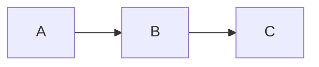
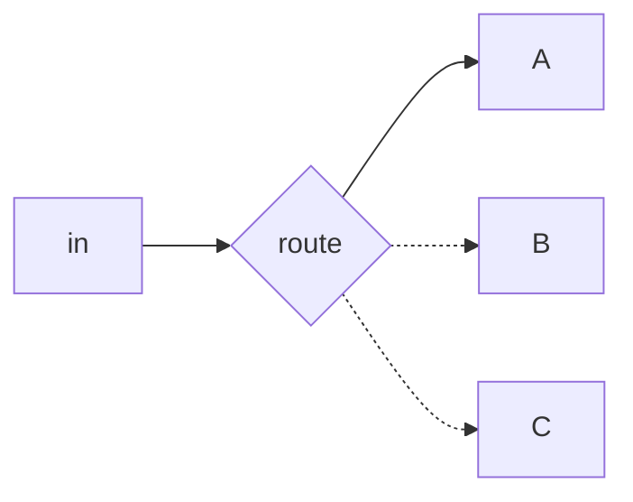
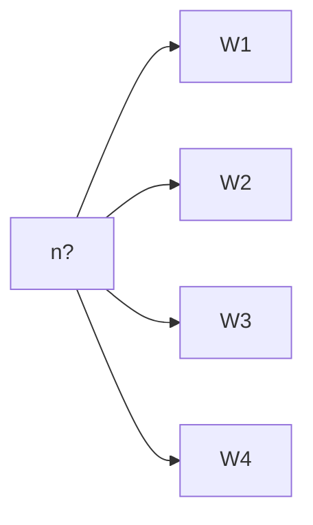
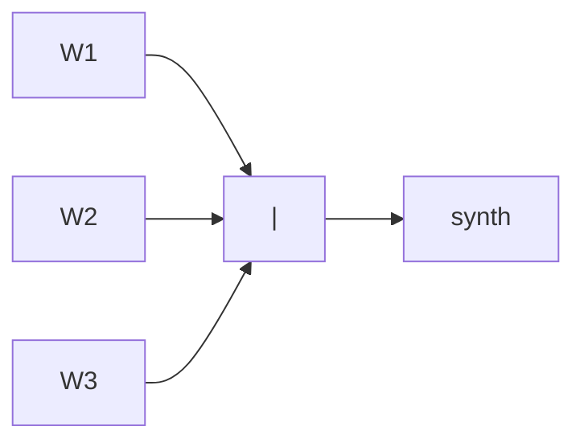
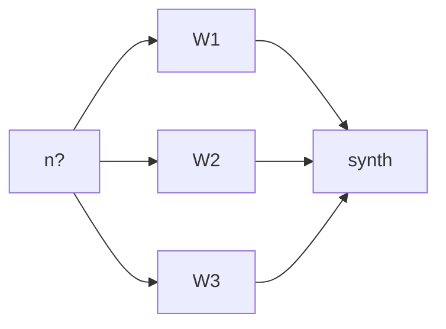
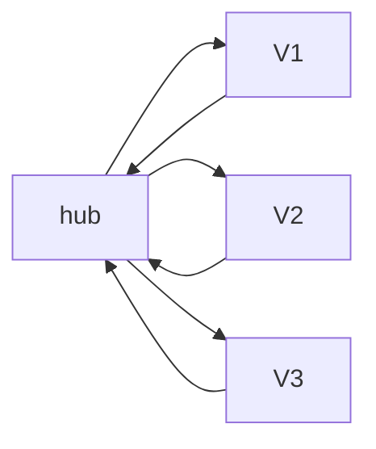
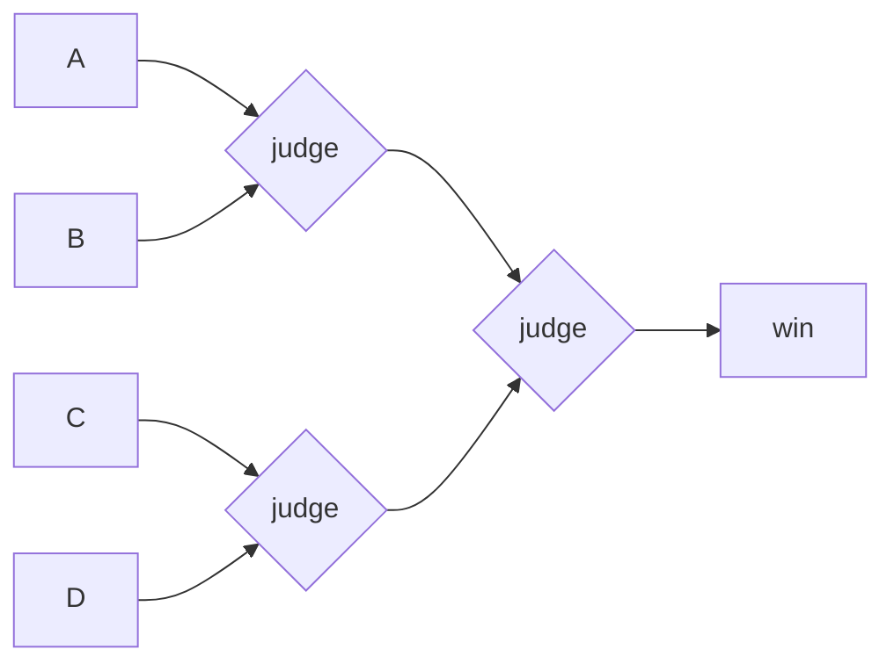
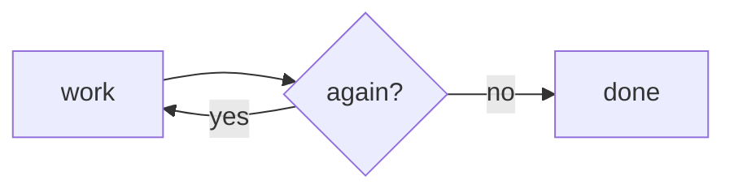
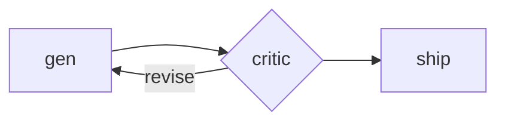
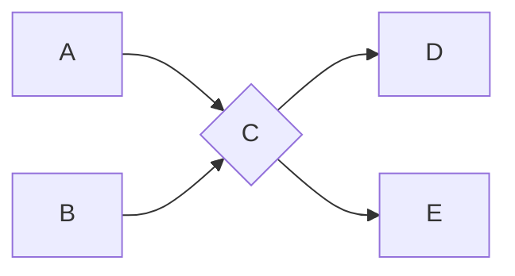

# Graph shapes — the vocabulary for an agent graph

DAE's execution graph is built from three things: **nodes** (an agent, or a
step that does one job), **edges** (what runs next: branch, fan-out, fan-in,
loop-back) and **state** (what moves along the edges: handoffs, `progress.md`,
`dae_*` JSON). The ten shapes below are the standard names for how those combine.
They describe the same things as Anthropic's published patterns (chaining,
routing, parallelization, orchestrator-workers, evaluator-optimizer); this file
does not add a separate discipline. A graph can contain loops: you reach for a
graph when a single loop is no longer enough.

> **Engineering the graph means choosing the shapes and deciding which edges are
> hardcoded. Making it dynamic means handing specific nodes to a model. Decide
> that separately for every node.**

Each shape has one natural **dynamic slot**, the node where a model earns its
place. Naming that slot is most of the design work. Everywhere else, hardcode
the edge.

Canonical source: the *Graph engineering* write-up (Notion). Decarchy carries a
copy of the same catalogue; keep the two in step. How to pick a shape for the
work in front of you is `parallelism.md`, and how `/engineer.run` composes
shapes across a whole feature is `coordinator.md`.

## The ten shapes

### 1. Chain (pipeline)
Each node's output feeds the next. This is the base case.

*Dynamic slot:* any single node can be a model step. The route never branches.

### 2. Branch (router)
One input and several possible outputs, of which **exactly one is taken**.

*Dynamic slot:* the router itself: a model reads the input and picks the path.

### 3. Fan-out (spray)
One input, many parallel workers, **no join**. Independent work that no later
node waits for.

*Dynamic slot:* the source decides how many workers to spawn (one per file found).

### 4. Fan-in (join / barrier)
Many inputs, one output. It waits for all of them, then merges.

*Dynamic slot:* the merge, which is either a plain concatenation or a model
that synthesises.

### 5. Diamond (fan-out + fan-in)
Split the work across N workers, wait at a barrier, then merge.

*Dynamic slot:* the count going out, the synthesis coming back, or both.

### 6. Star (hub-and-spoke)
A hub sends one artifact to several satellites and collects their verdicts.
Adversarial verification is a Star: one piece of work, N verifiers aimed at it.

*Dynamic slot:* the hub, which aggregates the verdicts and decides pass or fail.

### 7. Tree (tournament)
Leaves are judged in pairs, round by round, until one root is left. Generate
candidates, judge them in rounds, keep the winner.

*Dynamic slot:* every judge is a model call that compares its inputs.

### 8. Loop (until done)
A backward edge: a node repeats until a condition says stop.

*Dynamic slot:* the `again?` check. **This is the shape that needs a cap** (see
the loop rule below).

### 9. Feedback (critic / refine)
A Loop with two roles: generate, critique, revise, critique again, until the
work is good enough.

*Dynamic slot:* the critic, which judges quality and either sends the work back
or lets it through. A Feedback loop is a Loop, so it needs a cap.

### 10. DAG (general graph)
Any nodes, any dependency edges, no cycles. Every shape above is a special case
of a DAG.

*Dynamic slot:* any node. Put the routing wherever the work needs it.

## Three rules that apply to every shape

### The loop rule: every Loop declares a cap and a no-progress stop

**Every Loop or Feedback shape declares a `max_rounds` cap and a no-progress
condition. A loop without both is not a loop DAE will run.** It fails the
planning reflex (`parallelism.md`) the same way an unbounded fan-out would.

- **Cap.** A number fixed before round 1, never "until done". The default is 5
  when the work gives no better bound. When the bound comes from the work
  itself, use that, for example one round per failing test or per surviving mutant.
- **No-progress stop.** Two consecutive rounds that return the same outcome
  (the same gap, the same failing test, the same error) mean the builder cannot
  close it, so stop and surface it. The CP5 green loop uses
  `manifest.autonomy.stuck_loop_threshold` (default 3) instead of two.
- **What happens when it stops.** A loop that hits its cap or the no-progress
  stop sets `human_action_needed: yes` and names the open item. It never
  silently continues and never reports success.

A loop with a **human in it** (prototype iteration, `clarify`, an interview) is
exempt: the human is the cap. The rule covers loops where agents run round to
round without asking.

`gauntlet.md` is the worked instance (`max_rounds: 5`, the same gap twice
counts as no progress, and a regression stops the loop too).

### Over-branching: the skip-gate, not a magic number

Do not use a rule of thumb like "no more than five branches". DAE's skip-gate
(`parallelism.md`) is sharper. Stay sequential when the work is scalar or
N < 2, when the units depend on each other, when a human sign-off splits them,
or when they are cheaper to just do than to dispatch.

### Outside evidence: a fan-out is not verified by itself

A graph rarely fails loudly. When a sub-agent fails, the graph just returns
less. Parallel agents can also produce **organised nonsense**: confident,
consistent output that agrees with itself and is wrong. The only cure is
evidence from **outside** the agent system.

**Something outside the fan-out must check every Fan-out, Diamond, Star or Tree
result,** recorded as `verified_by: tool` (tests that actually ran, a script
that actually passed) or `verified_by: human`. `verified_by: judgment` from
another agent in the same fan-out does not count. A plan that leaves a fan-out
with only in-fan-out verification is called out by the planning reflex, and
`/engineer.run` refuses to execute it (`coordinator.md`).

## The pipeline, shape by shape

Which shape each part of the pipeline is. Some steps are chains on purpose,
and the table says so instead of forcing a shape onto them.

| Where | Shape | Dynamic slot | Outside evidence |
|---|---|---|---|
| Funnel: discuss / feature-init triage | **Branch** (express · full · prototype-first) | the router (size + clarity projection) | human confirms (choice point) |
| `/engineer.run` start | **Branch** (XS goes to express, everything else to the coordinator) | the coordinator | human, at the front gate |
| CP0 onboard: discover features | **Diamond** (modules × angles, then dedup) | the count; the dedup | human, at the charter sign-off |
| CP2 discover-acs, interview | **Chain**, deliberately: each pass reads the previous pass's answers | — | human |
| CP2 discover-acs, reverse-engineer mode | **Diamond** (four passes over existing material, then dedup) | the dedup | human, at the front gate |
| CP2 / CP4 exit: review panel | **Star** (artifact author is the hub; adviser and advocate are the satellites) | the hub's accept/reject | human, at the front gate |
| CP3 atdd | **Chain**, deliberately: spec, then guardian, then pipeline-builder, each consuming the last | — | `dae_gherkin` + the red run (tool) |
| CP4 plan: propose architecture | **Tree** when design angles fan out; otherwise a Chain | the judges; the human picks the root | human |
| CP5 implement: green loop | **Loop** (one failing test per round) | `again?` = any test still red | the test runner (tool) |
| CP5 implement: independent specs | **Diamond** (one TDD cycle per spec in worktrees; the barrier is a full suite run) | the count | full acceptance + unit run (tool) |
| CP5 exit: gauntlet | **Feedback** (builder and a fresh critic) | the critic | the captured bar artifact (tool) |
| CP6 refine | **Diamond** (Reuse / Quality / Efficiency lenses, then a charter filter) | the synthesis | tests re-run after the edits (tool) |
| CP7 verify | **Star** (the diff at the hub; arch-check and crap-analyzer as satellites) | the verdict | `dae_arch`, CRAP (tool) |
| CP8 harden | **Branch** (refinement-advisor picks the tools), then a **Diamond** of the picked tools | the router | mutation run, TLC / `lake build`, counterexample reproduced against real code (tool) |
| CP8 kill mutants | **Loop** (one survivor per round) | `again?` = survivors left | the mutation re-run (tool) |
| fix: pin | **Loop** (redraft until the spec is RED) | `again?` | the red run (tool) |
| A whole feature under `/engineer.run` | **DAG** of segments split by the human gates | the coordinator | the gates (human) + every node's own tool evidence |
| Several features | **Fan-out**, one coordinator per worktree (Decarchy) | — | each feature's own back gate |

## References

- `${CLAUDE_PLUGIN_ROOT}/references/parallelism.md`: the planning reflex that picks a shape for this run's work
- `${CLAUDE_PLUGIN_ROOT}/references/coordinator.md`: how `/engineer.run` composes shapes across a feature
- `${CLAUDE_PLUGIN_ROOT}/references/gauntlet.md`: the worked Feedback loop
- `${CLAUDE_PLUGIN_ROOT}/references/review-panel.md`: the CP2/CP4 Star
